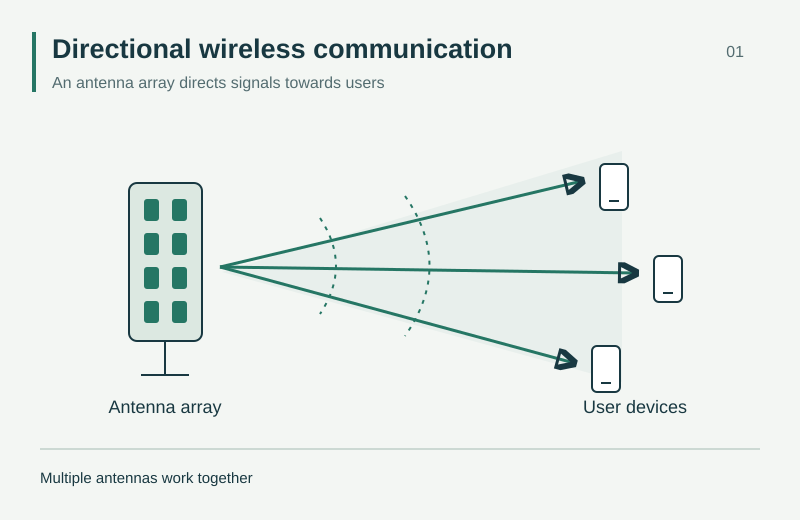
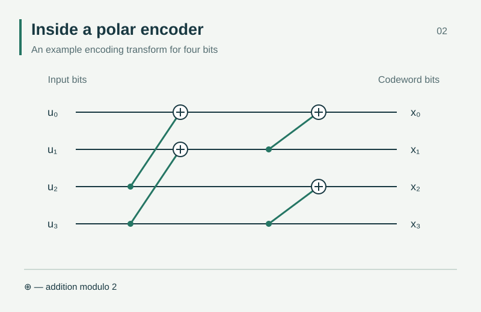
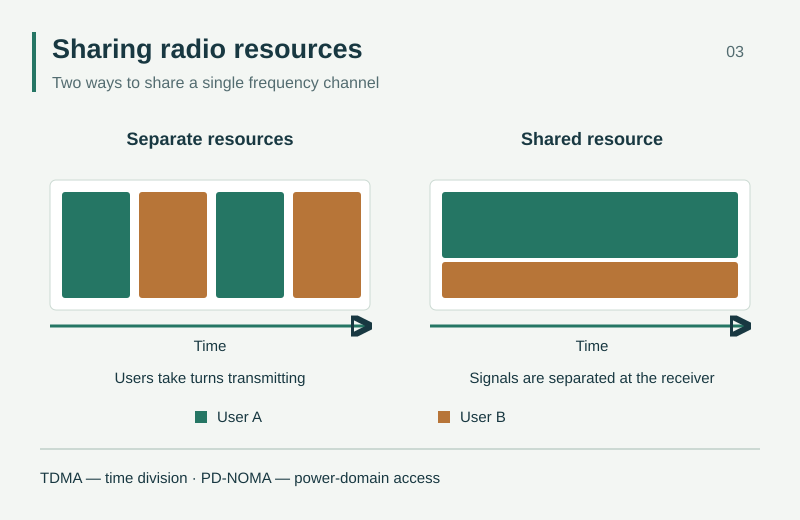
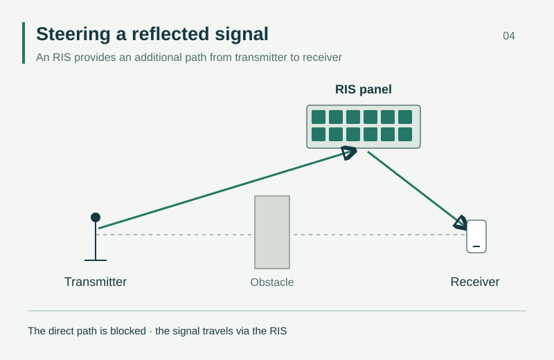

---
{
  "title": "Research diagrams",
  "lang": "en",
  "description": "Illustrations of our research: multi-antenna communication, polar codes, multiple access and RIS.",
  "pagetitle": "Research diagrams — Wireless Communication Laboratory",
  "include-before-body": [
    "../site-header-en.html"
  ],
  "toc-title": "On this page",
  "include-after-body": [
    "../navigation.html",
    "../site-footer-en.html"
  ],
  "include-in-header": [
    {
      "text": ""
    }
  ],
  "body-classes": "site-page media-page",
  "anchor-sections": false
}
---

These diagrams explain the principles of the systems we study; they do not show measurement results. For enquiries about using these illustrations or other laboratory materials, contact [laboratory317@gmail.com](mailto:laboratory317@gmail.com).

## Multi-antenna communications

{}

An antenna array directs signal transmission towards user devices.

## Polar coding

{}

An example transform for four input bits; ⊕ denotes addition modulo two.

## Multiple access

{}

A comparison of users transmitting in separate time slots (TDMA) and simultaneously at different power levels (PD-NOMA). Colours identify two users.

## Reconfigurable intelligent surfaces

{}

The RIS provides a reflected path between the transmitter and receiver when an obstacle blocks the direct path.
