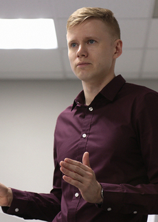
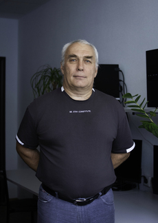
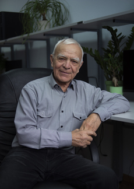
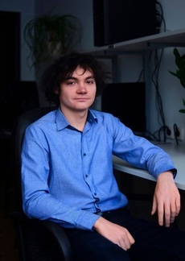
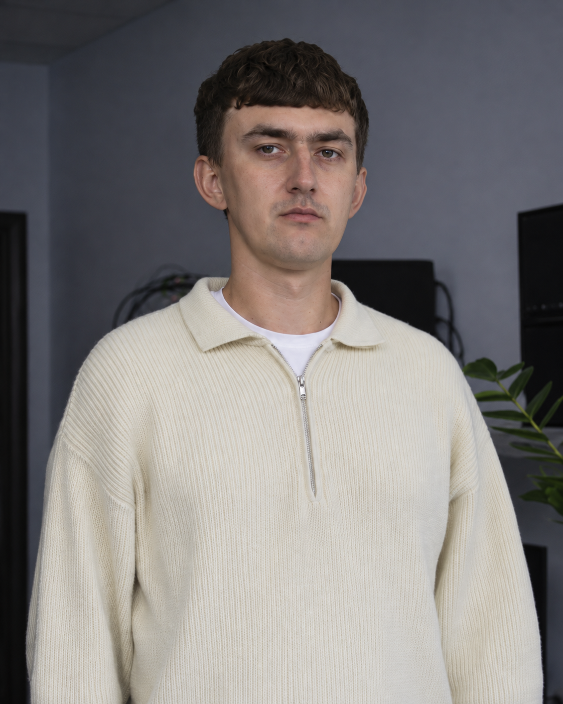
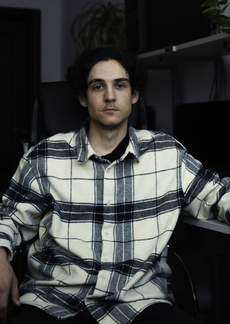
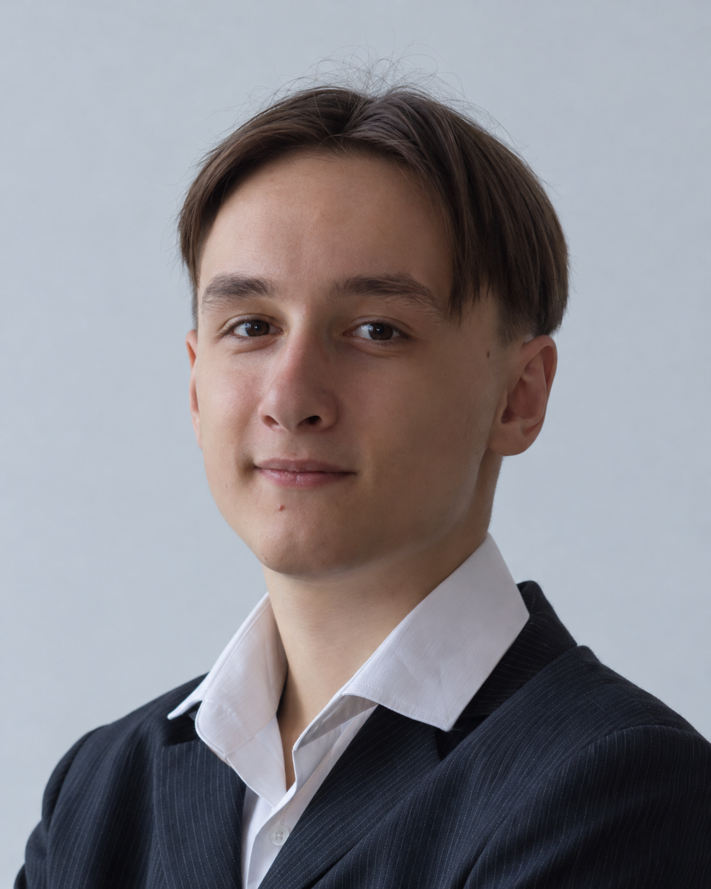

---
{
  "title": "Our team",
  "lang": "en",
  "description": "Laboratory staff and students, with research interests, publications and contact details.",
  "pagetitle": "Our team — Wireless Communication Laboratory",
  "include-before-body": [
    "../site-header-en.html"
  ],
  "toc-title": "On this page",
  "body-classes": "people-page portfolio-page site-page",
  "toc": false,
  "include-after-body": [
    "../navigation.html",
    "../site-footer-en.html"
  ],
  "include-in-header": [
    {
      "text": ""
    }
  ],
  "anchor-sections": false
}
---

<nav class="team-jump" aria-label="Team groups"><a href="#pokamestov">Research Staff</a><a href="#stepnoy">Engineers</a><a href="#shinkevich">Postgraduate Students</a><a href="#pogorelov">Students</a></nav>

## Research Staff

::::: {.team-grid}

:::: {.person-entry #pokamestov}

Research Staff

::: {.person-info}

### Dmitriy Pokamestov

Candidate of Technical Sciences, Associate Professor at the Department of Telecommunications and Basic Principles of Radio Engineering, TUSUR.

Research interests
<ul><li>Multiple access methods (NOMA, SCMA, RSMA)</li><li>Signal design and adaptation</li><li>Error correction coding (polar codes, LDPC)</li><li>Multiple antenna communication systems (MIMO)</li><li>Channel estimation and synchronization</li><li>Machine learning in telecommunications</li></ul>

<a class="person-publications" href="publications.html?researcher=Pokamestov">Publications by this researcher →</a>

<a href="mailto:dmaltomsk@mail.ru">E-mail ↗</a><a href="https://scholar.google.com/citations?user=-_7z65YAAAAJ&amp;hl=ru">Google Scholar ↗</a><a href="https://orcid.org/0000-0002-9405-4573">ORCID ↗</a><a href="cv-pokamestov.html">CV ↗</a>

Research identifiers

- **eLibrary AuthorID:** 860831
- **eLibrary SPIN code:** 7819-9512
- **WoS ResearcherID:** E-2544-2019
- **Scopus AuthorID:** 57188748446

:::

::::

:::: {.person-entry #kryukov}

Research Staff

::: {.person-info}

### Yakov Kryukov

Candidate of Technical Sciences, Associate Professor at the Department of Telecommunications and Basic Principles of Radio Engineering, TUSUR.

Research interests
<ul><li>Nonorthogonal multiple access (NOMA)</li><li>Radio resource management</li><li>Modulation and coding adaptation</li><li>Channel modeling with reconfigurable intelligent surfaces (RIS)</li><li>Massive machine type communications (mMTC)</li><li>Communication system synchronization</li></ul>

<a class="person-publications" href="publications.html?researcher=Kryukov">Publications by this researcher →</a>

<a href="mailto:iakov.v.kriukov@tusur.ru">E-mail ↗</a><a href="https://scholar.google.com/citations?user=Ms3raocp3REC&amp;hl=ru">Google Scholar ↗</a><a href="https://orcid.org/0000-0002-4115-9080">ORCID ↗</a><a href="cv-kryukov.html">CV ↗</a>

Research identifiers

- **eLibrary AuthorID:** 886532
- **eLibrary SPIN code:** 3956-3916
- **WoS ResearcherID:** AAG-5931-2020
- **Scopus AuthorID:** 57195284047

:::

::::

:::: {.person-entry #litvinov}

Research Staff

::: {.person-info}

### Rudolf Litvinov

Candidate of Physical and Mathematical Sciences, Associate Professor at the Department of Telecommunications and Basic Principles of Radio Engineering, TUSUR.

Research interests
<ul><li>Nonlinear optics</li><li>Wave propagation in metamaterials</li><li>Soliton formation and wave stability</li><li>Multiple access with rate splitting (RSMA)</li></ul>

<a class="person-publications" href="publications.html?researcher=Litvinov">Publications by this researcher →</a>

:::

::::

:::::

## Engineers

::::: {.team-grid}

:::: {.person-entry #stepnoy}

Engineers

::: {.person-info}

### Viktor Stepnoy

Senior Lecturer at the Department of Telecommunications and Basic Principles of Radio Engineering, TUSUR.

Research interests
<ul><li>Electromagnetic data transmission in downhole telemetry systems</li></ul>

<a class="person-publications" href="publications.html?researcher=Stepnoy">Publications by this researcher →</a>

<a href="mailto:stepnoyvs47@mail.ru">E-mail ↗</a>

:::

::::

:::::

## Postgraduate Students

::::: {.team-grid}

:::: {.person-entry #shinkevich}

Postgraduate Students

::: {.person-info}

### Artyom Shinkevich

Assistant at the Department of Telecommunications and Basic Principles of Radio Engineering, TUSUR.

Research interests
<ul><li>Multiple access with rate splitting (RSMA)</li><li>Multiple antenna communication systems (MIMO)</li><li>Spatial signal processing</li><li>Error correction coding (LDPC)</li></ul>

<a class="person-publications" href="publications.html?researcher=Shinkevich">Publications by this researcher →</a>

<a href="mailto:a.shinkevich00@gmail.com">E-mail ↗</a><a href="https://scholar.google.com/citations?user=TA-ngpgAAAAJ&amp;hl=ru">Google Scholar ↗</a><a href="https://orcid.org/0000-0002-0174-9158">ORCID ↗</a>

Research identifiers

- **eLibrary AuthorID:** 1213138
- **eLibrary SPIN code:** 8492-1845
- **Scopus AuthorID:** 57946915200

:::

::::

:::: {.person-entry #shalin}

Postgraduate Students

::: {.person-info}

### Georgy Shalin

Assistant at the Department of Telecommunications and Basic Principles of Radio Engineering, TUSUR.

Research interests
<ul><li>Polar coding and decoding</li><li>Coding adaptation to wireless channels</li><li>Improving the error performance of OFDM systems</li></ul>

<a class="person-publications" href="publications.html?researcher=Shalin">Publications by this researcher →</a>

<a href="https://orcid.org/0000-0001-5015-599X">ORCID ↗</a>

Research identifiers

- **eLibrary AuthorID:** 1213133
- **eLibrary SPIN code:** 1529-0615
- **Scopus AuthorID:** 57947072800

:::

::::

:::: {.person-entry #eremeev}

Postgraduate Students

::: {.person-info}

### Sergey Eremeev

Assistant at the Department of Telecommunications and Basic Principles of Radio Engineering, TUSUR.

Research interests
<ul><li>Modeling and experimental studies of reconfigurable intelligent surfaces (RIS)</li><li>Multipath radio channel modeling</li><li>Radio coverage assessment</li></ul>

<a class="person-publications" href="publications.html?researcher=Eremeev">Publications by this researcher →</a>

<a href="https://orcid.org/0009-0008-0570-5495">ORCID ↗</a>

Research identifiers

- **eLibrary AuthorID:** 1222191
- **eLibrary SPIN code:** 6544-0460
- **Scopus AuthorID:** 59296552300

:::

::::

:::: {.person-entry #ilinskiy}

Postgraduate Students

::: {.person-info}

### Dmitriy Ilinskiy

Assistant at the Department of Telecommunications and Basic Principles of Radio Engineering, TUSUR.

Research interests
<ul><li>Design and modeling of reconfigurable intelligent surface (RIS) elements</li><li>RIS circuit design</li><li>Radio coverage modeling</li></ul>

<a class="person-publications" href="publications.html?researcher=Ilinskiy">Publications by this researcher →</a>

<a href="https://orcid.org/0009-0008-8697-8945">ORCID ↗</a>

Research identifiers

- **eLibrary AuthorID:** 1215444
- **eLibrary SPIN code:** 4167-9931
- **WoS ResearcherID:** MFH-0927-2025
- **Scopus AuthorID:** 59296800900

:::

::::

:::::

## Students

::::: {.team-grid}

:::: {.person-entry #pogorelov}

Students

::: {.person-info}

### Evgeniy Dmitrievich Pogorelov

Student

Research interests
<ul><li>Machine learning in telecommunications</li></ul>

<a class="person-publications" href="publications.html">Laboratory publications →</a>

:::

::::

:::::

::: {.portfolio-contact}

### Join the team

Students interested in wireless communication can explore our research areas and contact the team to discuss a project.

[Student opportunities →](students.qmd) · [laboratory317@gmail.com](mailto:laboratory317@gmail.com)

:::
