---
{
  "title": "Error-correcting codes",
  "lang": "en",
  "description": "We study polar and LDPC codes, their adaptation to radio channel conditions and their use in multiple access systems.",
  "pagetitle": "Error-correcting codes — Wireless Communication Laboratory",
  "include-before-body": [
    "../site-header-en.html"
  ],
  "toc-title": "On this page",
  "body-classes": "research-detail-page site-page",
  "toc": true,
  "include-after-body": [
    "../navigation.html",
    "../site-footer-en.html"
  ],
  "include-in-header": [
    {
      "text": ""
    }
  ],
  "anchor-sections": false
}
---

[← All research areas](research.qmd)

Polar and LDPC codes provide error protection for transmitted data. We study how coding parameters and adaptation to radio channel conditions affect error rates.

We also investigate the use of polar codes with non-orthogonal multiple access. We evaluate these approaches using communication system models, including fading channel models.

The polar transform is shown for four input bits. Horizontal lines carry the bits; vertical connections implement addition modulo 2.

{.detail-diagram}

For LDPC codes, a Tanner graph describes the connections between codeword bits and parity checks. Circles represent bits, squares represent checks, and an edge indicates that a bit participates in a check.

{.detail-diagram}

Triple repetition is a simple example of error correction. If the channel corrupts one of three copies, the receiver recovers the bit from the two copies that agree.

{.detail-diagram}

::: {.research-context}

[POLAR · LDPC · CHANNEL CODING]{.portfolio-tags}

**Related projects**

RSF No. 24-29-00172 · 2024–2025

[Projects and funding →](projects.qmd#project-archive)

:::

## Related publications

::: {.research-evidence}

- **Adaptation of Polar Codes to Enhance BER Performance in Next-Generation Communication Systems.** Georgiy Shalin, Dmitriy Pokamestov, Yakov Kryukov, Artyom Shinkevich, Sergey Eremeev, Dmitriy Ilinskiy. *2025 IEEE 26th International Conference of Young Professionals in Electron Devices and Materials (EDM)*, pp. 330–333. 2025. [DOI](https://doi.org/10.1109/edm65517.2025.11096696)

- **Adaptation of signal with NOMA and polar codes to the Rayleigh channel.** Dmitriy Pokamestov, Yakov Kryukov, Eugeniy Rogozhnikov, Georgiy Shalin, Artem Shinkevich, Serafim Novichkov. *Symmetry*, vol. 14, no. 10, 2103. 2022. [DOI](https://doi.org/10.3390/sym14102103)

:::

[Full bibliography →](publications.qmd)
