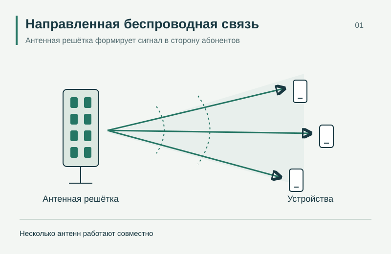
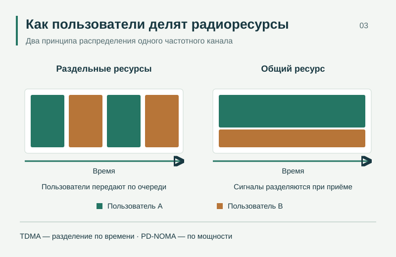
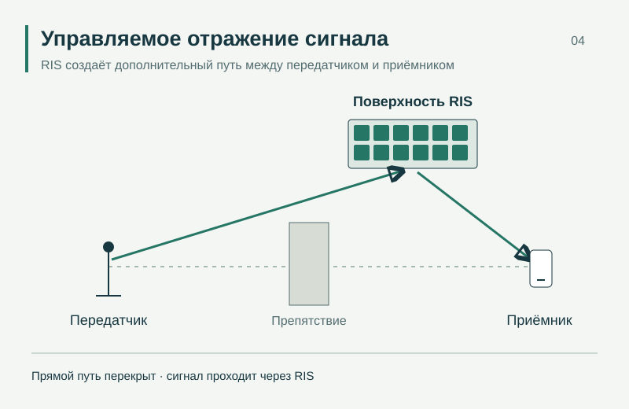

---
{
  "title": "Схемы исследований",
  "lang": "ru",
  "description": "Иллюстрации к исследованиям лаборатории: многоантенная связь, полярные коды, множественный доступ и RIS.",
  "pagetitle": "Схемы исследований — Лаборатория беспроводной связи",
  "include-before-body": [
    "../site-header-ru.html"
  ],
  "toc-title": "На этой странице",
  "include-after-body": [
    "../navigation.html",
    "../site-footer-ru.html"
  ],
  "include-in-header": [
    {
      "text": ""
    }
  ],
  "body-classes": "site-page media-page",
  "anchor-sections": false
}
---

Схемы поясняют принципы работы исследуемых систем и не представляют результаты измерений. По вопросам использования иллюстраций и других материалов лаборатории напишите на [laboratory317@gmail.com](mailto:laboratory317@gmail.com).

## Многоантенная связь

{}

Антенная решётка формирует направленную передачу сигнала к абонентским устройствам.

## Полярное кодирование

{}

Пример преобразования для четырёх входных битов; знак ⊕ обозначает сложение по модулю два.

## Множественный доступ

{}

Сравнение передачи по очереди (TDMA) и одновременной передачи с разделением по мощности (PD-NOMA). Два цвета соответствуют двум пользователям.

## Реконфигурируемые интеллектуальные поверхности

{}

RIS создаёт отражённый путь между передатчиком и приёмником, когда прямой путь перекрыт препятствием.
