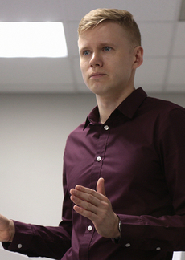
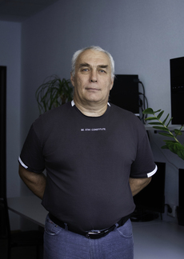
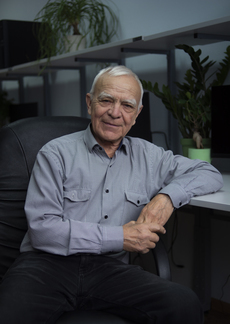
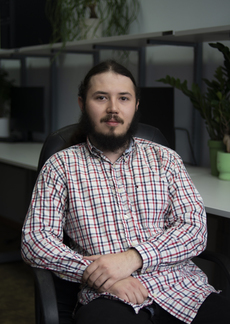
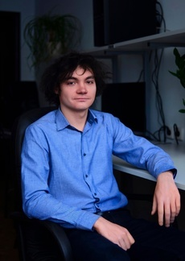
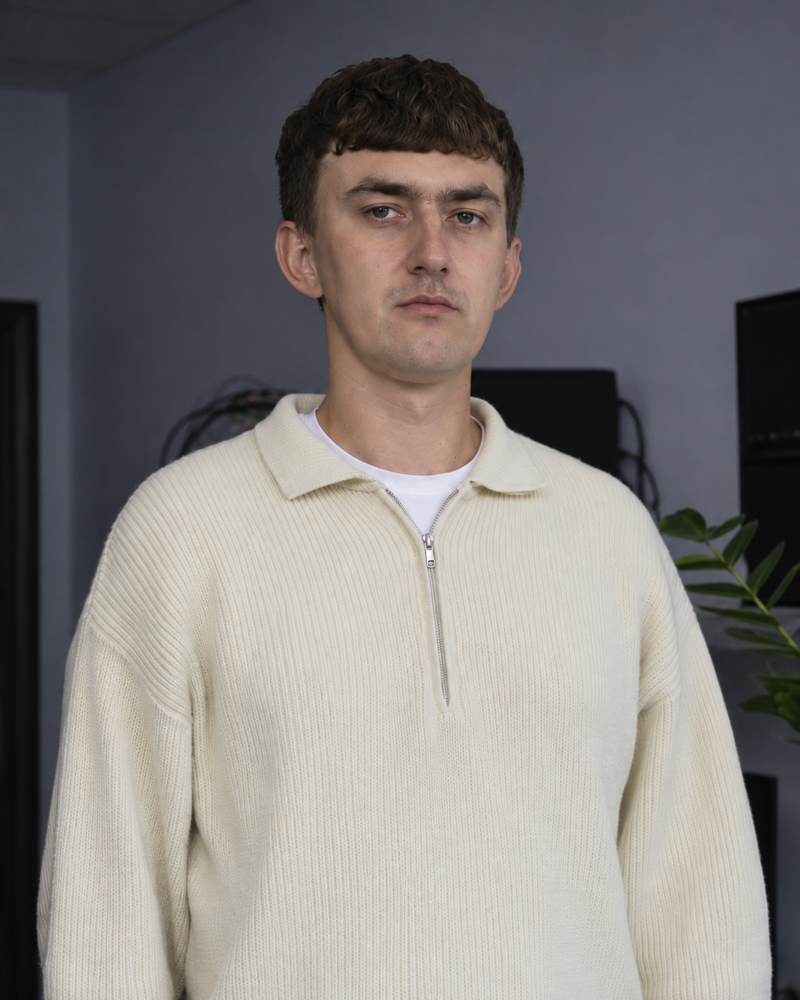
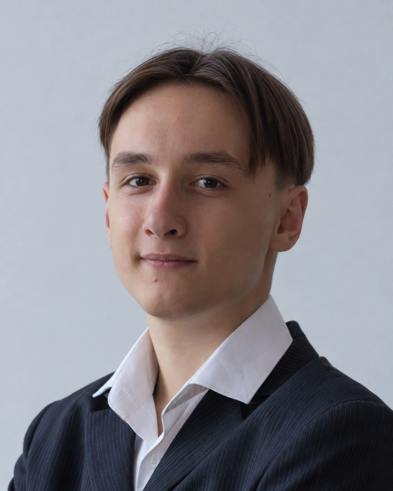

---
{
  "title": "Команда лаборатории",
  "lang": "ru",
  "description": "Научные интересы, публикации и контакты команды лаборатории.",
  "pagetitle": "Команда лаборатории — Лаборатория беспроводной связи",
  "include-before-body": [
    "../site-header-ru.html"
  ],
  "toc-title": "На этой странице",
  "body-classes": "people-page portfolio-page site-page",
  "toc": false,
  "include-after-body": [
    "../navigation.html",
    "../site-footer-ru.html"
  ],
  "include-in-header": [
    {
      "text": ""
    }
  ],
  "anchor-sections": false
}
---

:::::: {.team-grid}

::::: {.person-entry #pokamestov}

:::: {.person-header}

::: {.person-heading}

## Покаместов Дмитрий Алексеевич

Кандидат технических наук, доцент кафедры ТОР ТУСУР.

:::

::::

::: {.person-info}

Научные интересы
<ul><li>Методы множественного доступа (NOMA, SCMA, RSMA)</li><li>Синтез и адаптация сигналов</li><li>Помехоустойчивое кодирование (полярные коды, LDPC)</li><li>Многоантенные системы связи (MIMO)</li><li>Оценка канала и синхронизация</li><li>Машинное обучение в телекоммуникациях</li></ul>

<a class="person-publications" href="publications.html?researcher=%D0%9F%D0%BE%D0%BA%D0%B0%D0%BC%D0%B5%D1%81%D1%82%D0%BE%D0%B2">Публикации сотрудника →</a>

<a href="mailto:dmaltomsk@mail.ru">E-mail ↗</a><a href="https://scholar.google.com/citations?user=-_7z65YAAAAJ&amp;hl=ru">Google Scholar ↗</a><a href="https://orcid.org/0000-0002-9405-4573">ORCID ↗</a><a href="cv-pokamestov.html">CV ↗</a>

Научные идентификаторы

- **eLibrary AuthorID:** 860831
- **eLibrary SPIN-код:** 7819-9512
- **WoS ResearcherID:** E-2544-2019
- **Scopus AuthorID:** 57188748446

:::

:::::

::::: {.person-entry #kryukov}

:::: {.person-header}

::: {.person-heading}

## Крюков Яков Владимирович

Кандидат технических наук, доцент кафедры ТОР ТУСУР.

:::

::::

::: {.person-info}

Научные интересы
<ul><li>Неортогональный множественный доступ (NOMA)</li><li>Управление радиоресурсами</li><li>Адаптация модуляции и кодирования</li><li>Моделирование каналов с реконфигурируемыми поверхностями (RIS)</li><li>Массовая межмашинная связь (mMTC)</li><li>Синхронизация систем связи</li></ul>

<a class="person-publications" href="publications.html?researcher=%D0%9A%D1%80%D1%8E%D0%BA%D0%BE%D0%B2">Публикации сотрудника →</a>

<a href="mailto:iakov.v.kriukov@tusur.ru">E-mail ↗</a><a href="https://scholar.google.com/citations?user=Ms3raocp3REC&amp;hl=ru">Google Scholar ↗</a><a href="https://orcid.org/0000-0002-4115-9080">ORCID ↗</a><a href="cv-kryukov.html">CV ↗</a>

Научные идентификаторы

- **eLibrary AuthorID:** 886532
- **eLibrary SPIN-код:** 3956-3916
- **WoS ResearcherID:** AAG-5931-2020
- **Scopus AuthorID:** 57195284047

:::

:::::

::::: {.person-entry #litvinov}

:::: {.person-header}

::: {.person-heading}

## Литвинов Рудольф Викторович

Кандидат физико-математических наук, доцент кафедры ТОР ТУСУР.

:::

::::

::: {.person-info}

Научные интересы
<ul><li>Нелинейная оптика</li><li>Распространение волн в метаматериалах</li><li>Формирование солитонов и устойчивость волновых процессов</li><li>Множественный доступ с разделением по скорости (RSMA)</li></ul>

<a class="person-publications" href="publications.html?researcher=%D0%9B%D0%B8%D1%82%D0%B2%D0%B8%D0%BD%D0%BE%D0%B2">Публикации сотрудника →</a>

:::

:::::

::::: {.person-entry #stepnoy}

:::: {.person-header}

::: {.person-heading}

## Степной Виктор Серафимович

Старший преподаватель кафедры ТОР ТУСУР.

:::

::::

::: {.person-info}

Научные интересы
<ul><li>Электромагнитная передача данных в системах забойной телеметрии</li></ul>

<a class="person-publications" href="publications.html?researcher=%D0%A1%D1%82%D0%B5%D0%BF%D0%BD%D0%BE%D0%B9">Публикации сотрудника →</a>

<a href="mailto:stepnoyvs47@mail.ru">E-mail ↗</a>

:::

:::::

::::: {.person-entry #shinkevich}

:::: {.person-header}

::: {.person-heading}

## Шинкевич Артём Сергеевич

Ассистент кафедры ТОР ТУСУР.

:::

::::

::: {.person-info}

Научные интересы
<ul><li>Множественный доступ с разделением по скорости (RSMA)</li><li>Многоантенные системы связи (MIMO)</li><li>Пространственная обработка сигналов</li><li>Помехоустойчивое кодирование (LDPC)</li></ul>

<a class="person-publications" href="publications.html?researcher=%D0%A8%D0%B8%D0%BD%D0%BA%D0%B5%D0%B2%D0%B8%D1%87">Публикации сотрудника →</a>

<a href="mailto:a.shinkevich00@gmail.com">E-mail ↗</a><a href="https://scholar.google.com/citations?user=TA-ngpgAAAAJ&amp;hl=ru">Google Scholar ↗</a><a href="https://orcid.org/0000-0002-0174-9158">ORCID ↗</a>

Научные идентификаторы

- **eLibrary AuthorID:** 1213138
- **eLibrary SPIN-код:** 8492-1845
- **Scopus AuthorID:** 57946915200

:::

:::::

::::: {.person-entry #shalin}

:::: {.person-header}

::: {.person-heading}

## Шалин Георгий Николаевич

Ассистент кафедры ТОР ТУСУР.

:::

::::

::: {.person-info}

Научные интересы
<ul><li>Полярное кодирование и декодирование</li><li>Адаптация кодирования к радиоканалу</li><li>Повышение помехоустойчивости систем OFDM</li></ul>

<a class="person-publications" href="publications.html?researcher=%D0%A8%D0%B0%D0%BB%D0%B8%D0%BD">Публикации сотрудника →</a>

<a href="https://orcid.org/0000-0001-5015-599X">ORCID ↗</a>

Научные идентификаторы

- **eLibrary AuthorID:** 1213133
- **eLibrary SPIN-код:** 1529-0615
- **Scopus AuthorID:** 57947072800

:::

:::::

::::: {.person-entry #eremeev}

:::: {.person-header}

::: {.person-heading}

## Еремеев Сергей Александрович

Ассистент кафедры ТОР ТУСУР.

:::

::::

::: {.person-info}

Научные интересы
<ul><li>Моделирование и экспериментальное исследование реконфигурируемых поверхностей (RIS)</li><li>Моделирование многолучевых радиоканалов</li><li>Оценка радиопокрытия</li></ul>

<a class="person-publications" href="publications.html?researcher=%D0%95%D1%80%D0%B5%D0%BC%D0%B5%D0%B5%D0%B2">Публикации сотрудника →</a>

<a href="https://orcid.org/0009-0008-0570-5495">ORCID ↗</a>

Научные идентификаторы

- **eLibrary AuthorID:** 1222191
- **eLibrary SPIN-код:** 6544-0460
- **Scopus AuthorID:** 59296552300

:::

:::::

::::: {.person-entry #ilinskiy}

:::: {.person-header}

::: {.person-heading}

## Ильинский Дмитрий Евгеньевич

Ассистент кафедры ТОР ТУСУР.

:::

::::

::: {.person-info}

Научные интересы
<ul><li>Разработка и моделирование элементов реконфигурируемых поверхностей (RIS)</li><li>Схемотехника RIS</li><li>Моделирование радиопокрытия</li></ul>

<a class="person-publications" href="publications.html?researcher=%D0%98%D0%BB%D1%8C%D0%B8%D0%BD%D1%81%D0%BA%D0%B8%D0%B9">Публикации сотрудника →</a>

<a href="https://orcid.org/0009-0008-8697-8945">ORCID ↗</a>

Научные идентификаторы

- **eLibrary AuthorID:** 1215444
- **eLibrary SPIN-код:** 4167-9931
- **WoS ResearcherID:** MFH-0927-2025
- **Scopus AuthorID:** 59296800900

:::

:::::

::::: {.person-entry #pogorelov}

:::: {.person-header}

::: {.person-heading}

## Погорелов Евгений Дмитриевич

:::

::::

::: {.person-info}

Научные интересы
<ul><li>Машинное обучение в телекоммуникациях</li></ul>

<a class="person-publications" href="publications.html">Публикации лаборатории →</a>

:::

:::::

::::::

::: {.portfolio-contact}

## Присоединиться к команде

Студентам, которые хотят заниматься беспроводной связью, предлагаем познакомиться с направлениями исследований и обсудить тему работы с лабораторией.

[Студентам →](students.qmd) · [laboratory317@gmail.com](mailto:laboratory317@gmail.com)

:::
