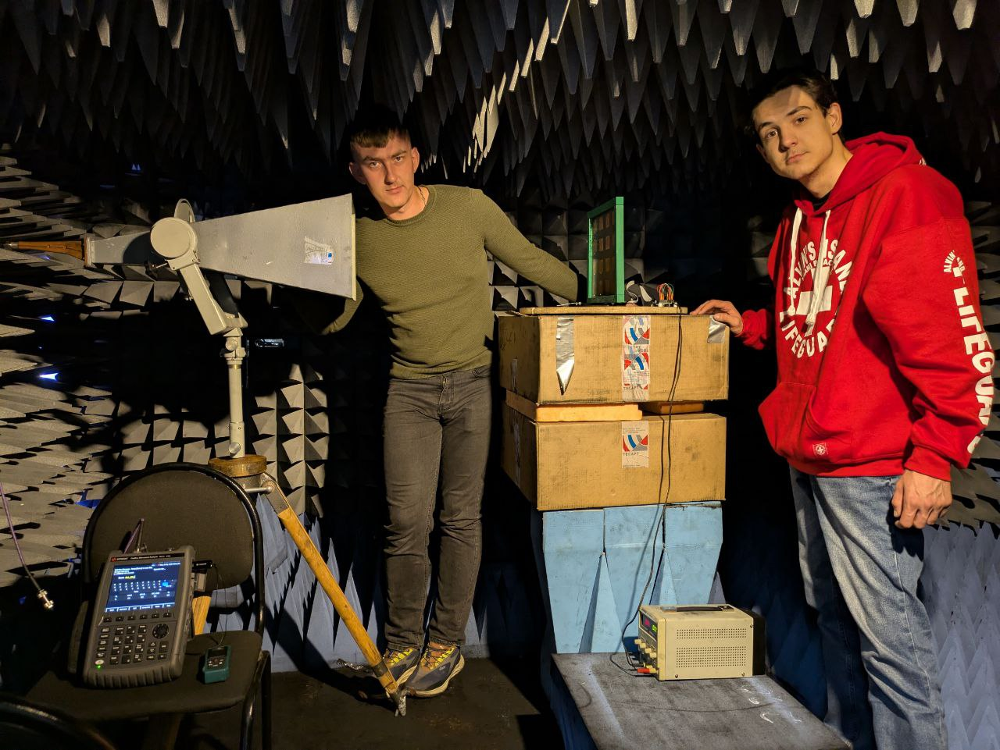
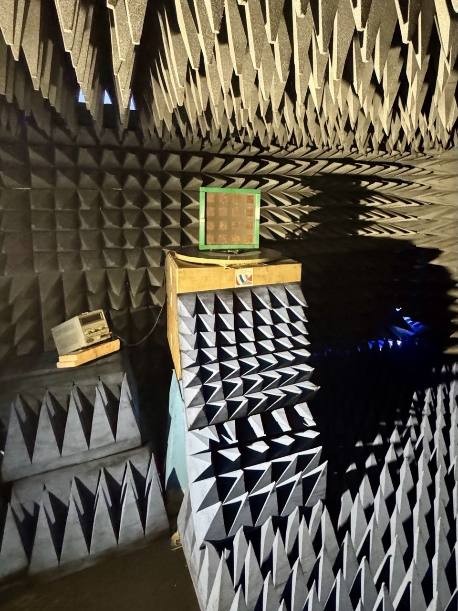
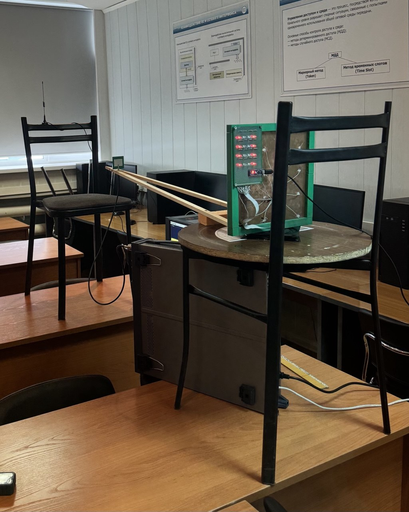
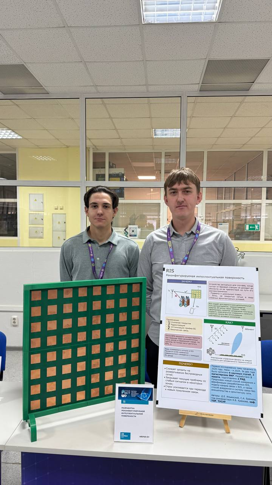

---
{
  "title": "Интеллектуальные поверхности",
  "lang": "ru",
  "description": "Моделируем радиоканалы с RIS и STAR-RIS, исследуем алгоритмы управления поверхностями и создаём экспериментальные прототипы.",
  "pagetitle": "Интеллектуальные поверхности — Лаборатория беспроводной связи",
  "include-before-body": [
    "../site-header-ru.html"
  ],
  "toc-title": "На этой странице",
  "body-classes": "research-detail-page site-page",
  "toc": true,
  "include-after-body": [
    "../navigation.html",
    "../site-footer-ru.html"
  ],
  "include-in-header": [
    {
      "text": ""
    }
  ],
  "anchor-sections": false
}
---

[← Все направления](research.qmd)

::: {.research-context}

[RIS · STAR-RIS · RF DESIGN]{.portfolio-tags}

**Связанные проекты**

ПИШ · УМНИК · Приоритет 2030

[Проекты и финансирование →](projects.qmd#project-archive)

:::

Реконфигурируемая интеллектуальная поверхность (RIS) изменяет отражение радиосигналов и тем самым влияет на радиоканал. В лаборатории моделируем такие каналы, разрабатываем алгоритмы управления поверхностями и проверяем их на экспериментальных прототипах.

Исследования RIS начались в 2023 году по инициативе сотрудников и студентов лаборатории. Первые работы выполняли студенты четвёртого курса: в выпускных квалификационных работах они моделировали базовые сценарии применения RIS.

Затем исследования продолжились в проекте Передовой инженерной школы (ПИШ) ТУСУР. Конкурс УМНИК поддержал переход к изготовлению прототипов. Разработаны и изготовлены поверхности на [16](#ris-prototype) и [64 элемента](#ris-exhibition).

Для 16-элементной поверхности созданы контроллер и программное обеспечение для настройки RIS и оценки её работы в реальном времени. Также разрабатывается модуль управления с мобильного телефона. Для [измерений в безэховой камере](#ris-chamber) студенты разработали [поворотное устройство на шаговом двигателе со световой индикацией](#ris-control).

Два выпускника, начавшие заниматься RIS во время обучения, продолжили эту работу в аспирантуре. Исследуем алгоритмы управления поверхностями, дистанционное управление с мобильного устройства и применение RIS в неназемных сетях связи. Ещё одна тема — STAR-RIS: поверхности, которые одновременно отражают и пропускают электромагнитные волны.

Работа охватывает СВЧ-моделирование, антенную технику, проектирование конструкций и печатных плат, разработку контроллеров и радиотехнические измерения. Результаты представлены в научных публикациях, на конференциях EDM и научно-технических выставках, включая [«Рост UP»](#ris-exhibition), а также в выпускных работах студентов.

В этом направлении объединены моделирование и разработка алгоритмов, доработка прототипов и методик измерения, а также подготовка студентов к исследовательской и инженерной работе.

## Прототипы и экспериментальная работа

:::: {.research-gallery}

::: {#ris-chamber .research-photo}

{loading="lazy"}

:::

::: {#ris-prototype .research-photo}

{loading="lazy"}

:::

::: {#ris-control .research-photo}

{loading="lazy"}

:::

::: {#ris-exhibition .research-photo}

{loading="lazy"}

:::

::::

## Публикации по теме

::: {.research-evidence}

- **Influence of Phase States of Binary Unit Cell on Ris Characteristics.** Sergey Eremeev, Dmitriy Ilinskiy, Yakov Kryukov, Dmitriy Pokamestov, Eugeniy Rogozhnikov, Ivan Rybakov. *2025 IEEE 26th International Conference of Young Professionals in Electron Devices and Materials (EDM)*, pp. 520–524. 2025. [DOI](https://doi.org/10.1109/edm65517.2025.11096689)

- **Modeling and Prototyping of Unit Cell for Reconfigurable Intelligent Surface: Electromagnetic Model, Design and Circuitry.** Dmitriy Ilinskiy, Sergey Eremeev, Yakov Kryukov, Dmitriy Pokamestov, Georgiy Shalin, Artem Shinkevich. *2025 IEEE 26th International Conference of Young Professionals in Electron Devices and Materials (EDM)*, pp. 450–453. 2025.

:::

[Полная библиография →](publications.qmd)
