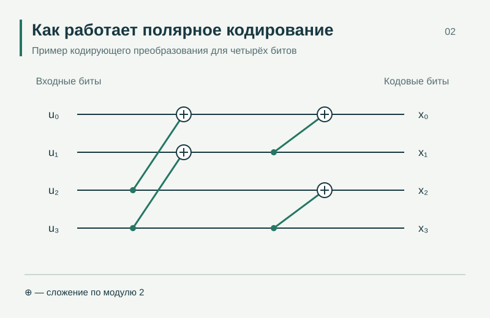

---
{
  "title": "Полярные коды",
  "lang": "ru",
  "description": "Исследуем полярные коды: адаптацию к условиям радиоканала и применение в системах неортогонального множественного доступа.",
  "pagetitle": "Полярные коды — Лаборатория беспроводной связи",
  "include-before-body": [
    "../site-header-ru.html"
  ],
  "toc-title": "На этой странице",
  "body-classes": "research-detail-page site-page",
  "toc": true,
  "include-after-body": [
    "../navigation.html",
    "../site-footer-ru.html"
  ],
  "include-in-header": [
    {
      "text": ""
    }
  ],
  "anchor-sections": false
}
---

[← Все направления](research.qmd)

Полярные коды применяются для помехоустойчивой передачи данных. Исследуем, как выбор параметров кодирования и адаптация к условиям радиоканала влияют на вероятность ошибок.

Отдельная часть работ посвящена применению полярных кодов совместно с неортогональным множественным доступом. Проверяем решения с помощью моделей систем связи, в том числе для каналов с замираниями.

{.detail-diagram}

::: {.research-context}

[POLAR CODES · CHANNEL CODING]{.portfolio-tags}

**Связанные проекты**

РНФ № 24-29-00172 · 2024–2025

[Проекты и финансирование →](projects.qmd#project-archive)

:::

## Публикации по теме

::: {.research-evidence}

- **Adaptation of Polar Codes to Enhance BER Performance in Next-Generation Communication Systems.** Georgiy Shalin, Dmitriy Pokamestov, Yakov Kryukov, Artyom Shinkevich, Sergey Eremeev, Dmitriy Ilinskiy. *2025 IEEE 26th International Conference of Young Professionals in Electron Devices and Materials (EDM)*, pp. 330–333. 2025. [DOI](https://doi.org/10.1109/edm65517.2025.11096696)

- **Adaptation of signal with NOMA and polar codes to the Rayleigh channel.** Dmitriy Pokamestov, Yakov Kryukov, Eugeniy Rogozhnikov, Georgiy Shalin, Artem Shinkevich, Serafim Novichkov. *Symmetry*, vol. 14, no. 10, 2103. 2022. [DOI](https://doi.org/10.3390/sym14102103)

:::

[Полная библиография →](publications.qmd)
